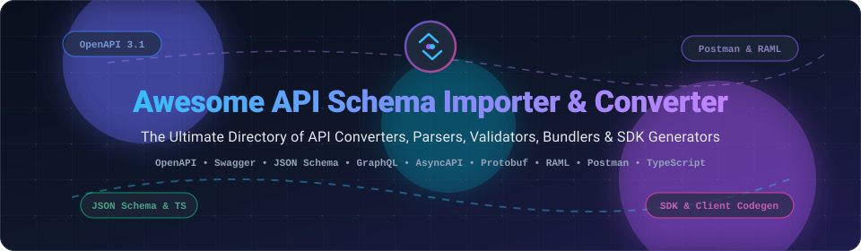

  

# 🚀 Awesome API Schema Importer & Converter

  
  
  
  
  
  
  

---

## 📖 Table of Contents
- [✨ Overview](#-overview)
- [📊 Sector Overview & Market Dynamics](#-sector-overview--market-dynamics)
- [☁️ SaaS Platforms](#-saas-platforms)
- [🛠️ Open-Source Converters & Generators](#️-open-source-converters--generators)
- [💡 Workflows & Conversion Patterns](#-workflows--conversion-patterns)
- [📈 Star History](#-star-history)
- [💖 Support & Contributing](#-support--contributing)

---

## ✨ Overview

Welcome to the definitive, search-optimized curated guide to **API schema converters, importers, spec bundlers, code generators, and parsers**. Whether you are migrating from **Postman Collections** or **Swagger 2.0** to **OpenAPI 3.1**, generating typed TypeScript interfaces, mocking contract-adherent endpoints, or building multi-language SDKs, this directory tracks industry-standard tools across open-source and commercial ecosystems.

**Supported Formats & Standards:**
`OpenAPI 3.0 / 3.1` • `Swagger 2.0` • `JSON Schema` • `RAML` • `GraphQL Schema` • `Protocol Buffers (Protobuf)` • `AsyncAPI` • `API Blueprint` • `WSDL` • `Postman Collection v2/v2.1`

---

## 📊 Sector Overview & Market Dynamics

The global API management and developer tooling market is estimated at approximately **$8.0B to $10.3B** (projected to reach **$22B–$37B+** by the early 2030s at an estimated compound annual growth rate of ~16%–25%). 

The sector exhibits a **moderately fragmented** structure overall:
- **Core Infrastructure & Gateways (Concentrated):** Dominated by hyperscalers and legacy enterprise software giants (e.g., Google Cloud Apigee, AWS API Gateway, Azure API Management, IBM, Broadcom Layer7).
- **Tooling, Transformation & Developer Experience (Highly Fragmented):** Surrounding specialized layers—such as schema converters, contract linters, mock servers, automated SDK generators, and developer documentation engines—remain highly fragmented, driven by product-led growth, open-source innovations, and rapid venture-funded startup entry.

---

## ☁️ SaaS Platforms

| Product | Company Size (Valuation / Revenue) | Pricing | Free Tier Limit | Primary Capabilities & Schema Support |
| :--- | :--- | :--- | :--- | :--- |
| **[Postman](https://www.postman.com)** | **$5.6B Valuation** (~$270M–$313M ARR) | Starts at **$9/user/month** (Solo, billed annually) or $19/user/month (Team) | **Free Forever**: 1 user only, shared workspace collaboration disabled, capped at 1,000 monthly cloud requests / mock server calls / monitor runs. | API client & Spec Hub importing OpenAPI 2.0/3.0/3.1, AsyncAPI, RAML, GraphQL, WSDL, and Protocol Buffers. |
| **[Stoplight (SmartBear)](https://stoplight.io)** | **~$150M+ Parent Revenue** (Acquired by SmartBear, previously raised ~$26M) | Starts at **$44/month** (Basic plan, billed annually) | **Free Forever**: 1 user seat, 1 active design project, basic mock server, and read-only published docs. | Visual OpenAPI designer, Prism mock engine, schema validation, and spectral linting. |
| **[Speakeasy](https://www.speakeasy.com)** | **~$25.9M Funding** (Valued at ~$25M–$50M+) | Starts at **$600/month per language target** (Business plan, billed annually) | **Free Forever**: 1 language target, up to 250 operations/endpoints, manual triggers, and community support. | Automated SDK and CLI generator from OpenAPI 3.0/3.1 specs, contract validation, and AI agent toolchain generation. |
| **[Redocly](https://redocly.com)** | **~$7.8M Estimated Revenue** (Bootstrapped / Seed stage) | Starts at **$249/month** (Pro plan, billed annually) | **30-Day Free Trial**: Full Pro plan access for 30 days (up to 3 projects, unlimited seats; no permanent hosted free tier). CLI and core renderer remain free open source. | API catalog portals, OpenAPI 3.x bundler (`redocly bundle` for inlining `$ref`), linter, and markdown-integrated docs. |
| **[APIMatic](https://www.apimatic.io)** | **~$5.1M Estimated Revenue** (Bootstrapped / ~$517K Seed funding) | Starts at **$10/month** (Lite plan) or $300/month (Basic plan, billed annually) | **14-Day Free Trial**: 14 days of full feature access with no credit card required (no ongoing hosted free tier). CLI provides local validation. | Multi-format bidirectional schema transformer (OpenAPI/Swagger, RAML, API Blueprint, WSDL, Postman to OpenAPI), SDK generation. |

---

## 🛠️ Open-Source Converters & Generators

Sorted in descending order by GitHub stargazers. Each badge links directly to the repository's stargazers page.

| Project & Repo | Stars | Primary Language | License | Key Features & Conversion Capabilities |
| :--- | :--- | :--- | :--- | :--- |
| **[OpenAPITools/openapi-generator](https://github.com/OpenAPITools/openapi-generator)** |  | Java | Apache 2.0 | Complete code generator transforming OpenAPI (v2.0, v3.0, v3.1) into SDK clients, server stubs, configurations, and documentation across 50+ languages. |
| **[Redocly/redoc](https://github.com/Redocly/redoc)** |  | TypeScript | MIT | OpenAPI/Swagger spec viewer, parser, and responsive documentation generator with zero configuration and deep nested schema resolution. |
| **[swagger-api/swagger-codegen](https://github.com/swagger-api/swagger-codegen)** |  | Java / Mustache | Apache 2.0 | The original specification-driven client generator, server stub producer, and documentation engine parsing Swagger and OpenAPI specs. |
| **[ritz078/transform](https://github.com/ritz078/transform)** |  | TypeScript | MIT | In-browser, client-side polyglot converter ([transform.tools](https://transform.tools)) for JSON to TypeScript, GraphQL to TypeScript/Flow, JSON Schema, and more. |
| **[openapi-ts/openapi-typescript](https://github.com/openapi-ts/openapi-typescript)** |  | TypeScript | MIT | Blazing fast CLI & Node library that parses OpenAPI 3.0 and 3.1 schemas and produces pure, strongly typed TypeScript definitions at build time. |
| **[stoplightio/prism](https://github.com/stoplightio/prism)** |  | TypeScript | Apache 2.0 | Turn OpenAPI v2/v3 and Postman Collections into live mock servers with contract-compliant simulated responses and strict schema validation. |
| **[datamodel-code-generator](https://github.com/koxudaxi/datamodel-code-generator)** |  | Python | MIT | Converts OpenAPI, JSON Schema, GraphQL schemas, and raw JSON/YAML payloads into typed Python models (Pydantic v1/v2, dataclasses, TypedDict). |
| **[bcherny/json-schema-to-typescript](https://github.com/bcherny/json-schema-to-typescript)** |  | TypeScript | MIT | Compiles JSON Schema (Draft 04/07) into production-ready TypeScript typings with support for complex `$ref` resolution and union types. |
| **[stoplightio/spectral](https://github.com/stoplightio/spectral)** |  | TypeScript | Apache 2.0 | Flexible JSON/YAML and API schema linter with built-in rule sets for OpenAPI v2/v3 and AsyncAPI, enforcing organization-wide schema consistency. |
| **[Redocly/redocly-cli](https://github.com/Redocly/redocly-cli)** |  | TypeScript | MIT | CLI toolkit for OpenAPI and AsyncAPI: multi-file spec bundling (`redocly bundle` inlines `$ref`), schema linting, splitting, and previewing. |
| **[opticdev/optic](https://github.com/opticdev/optic)** |  | TypeScript | MIT | Schema drift prevention and automated diffing for OpenAPI definitions, tracking backwards-incompatible breaking changes in Git pull requests. |
| **[pb33f/libopenapi](https://github.com/pb33f/libopenapi)** |  | Go | Apache 2.0 | Ultra-fast, high-performance Go parser, resolver, and compiler for OpenAPI 3+, OpenAPI 2 (Swagger), and JSON Schema definitions. |
| **[swagger-api/swagger-parser](https://github.com/swagger-api/swagger-parser)** |  | Java | Apache 2.0 | Java library that parses and validates OpenAPI and Swagger definitions into Java object models, resolving external references and circular schemas. |
| **[apimatic/apimatic-cli](https://github.com/apimatic/apimatic-cli)** |  | TypeScript | Apache 2.0 | Command-line interface to convert schemas across 14 formats (OpenAPI/Swagger, RAML, WSDL, Postman Collections, API Blueprint) and trigger SDK builds. |
| **[speakeasy-api/openapi-generation](https://github.com/speakeasy-api/openapi-generation)** |  | Go | AGPL-3.0 | Core open-source generation engine used by Speakeasy for parsing and validating OpenAPI definitions to generate production SDKs. |

---

## 💡 Workflows & Conversion Patterns

1. **Schema-to-Schema Translation**:
   Convert legacy formats (e.g., Postman Collections, WSDL, RAML, or Swagger 2.0) into standard OpenAPI 3.1 definitions via `apimatic-cli` or `swagger-parser`.
2. **Multi-File Spec Bundling & Inlining**:
   Resolve split modular repositories and external `$ref` pointers into unified self-contained schema artifacts using `redocly bundle`.
3. **Spec-to-Code & SDK Generation**:
   Compile API specifications into typed client packages, CLI binaries, and server route stubs with `openapi-generator`, `openapi-typescript`, or `datamodel-code-generator`.
4. **Contract Testing & Dynamic Mocking**:
   Validate live HTTP requests and spin up local mock servers matching schemas with `stoplightio/prism` or `optic`.

---

## 📈 Star History

---

## 💖 Support & Contributing

Contributions are always welcome! If you know of an awesome API schema converter, bundler, parser, or generator that belongs on this list, feel free to open a Pull Request or issue.

If you found this repository helpful, please consider showing your support:
- ⭐ **Star this repository** to help others discover it.
- 🍴 **Fork it** to bookmark and customize your own tooling workflows.
- 📢 **Share it** with your engineering team and developer communities.
- ☕ **Buy me a coffee**: Support ongoing maintenance on the [GitHub Sponsors Dashboard](https://github.com/sponsors/ishandutta2007).

Thank you for being part of the open-source community! 💙
